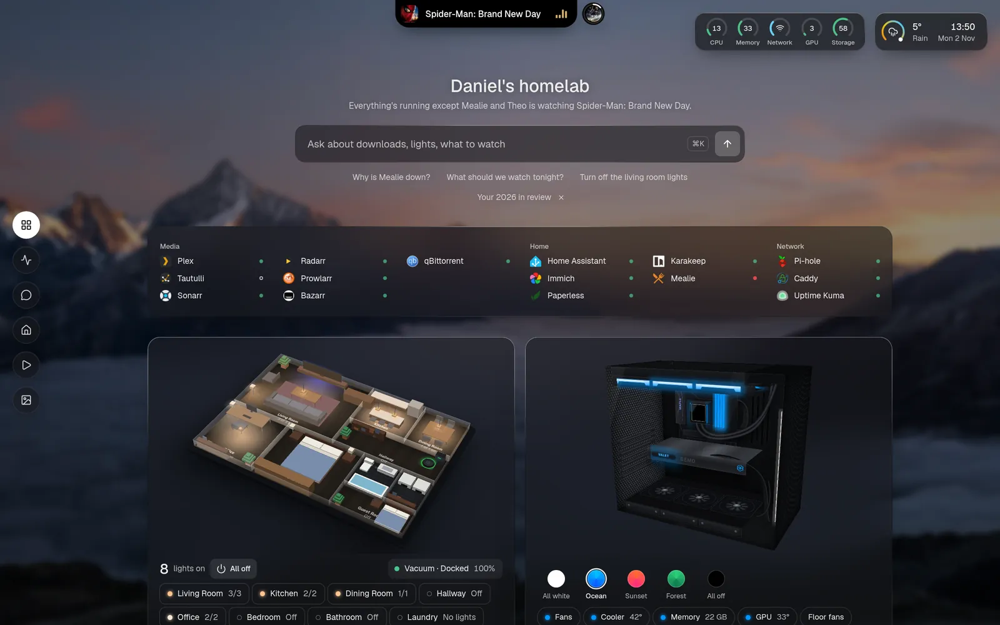
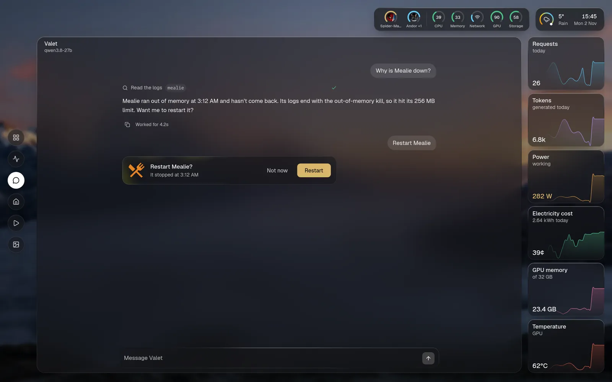
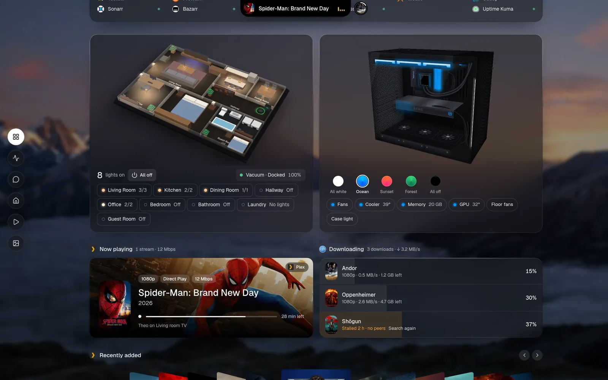
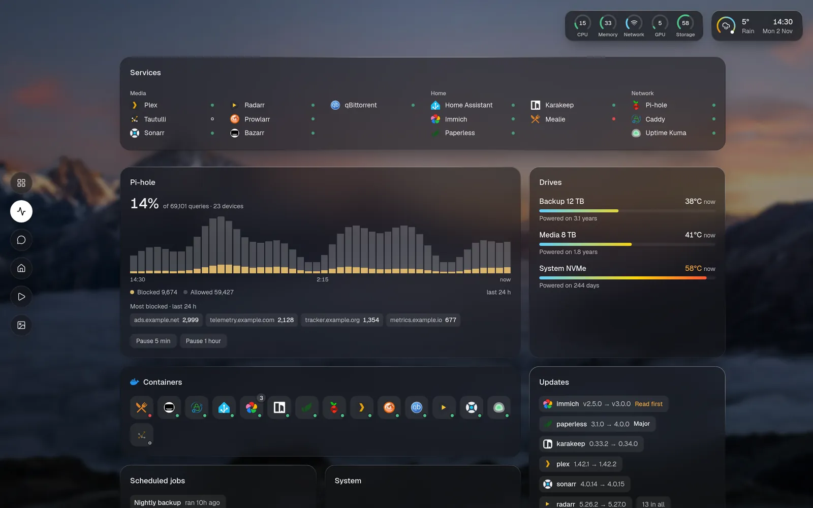
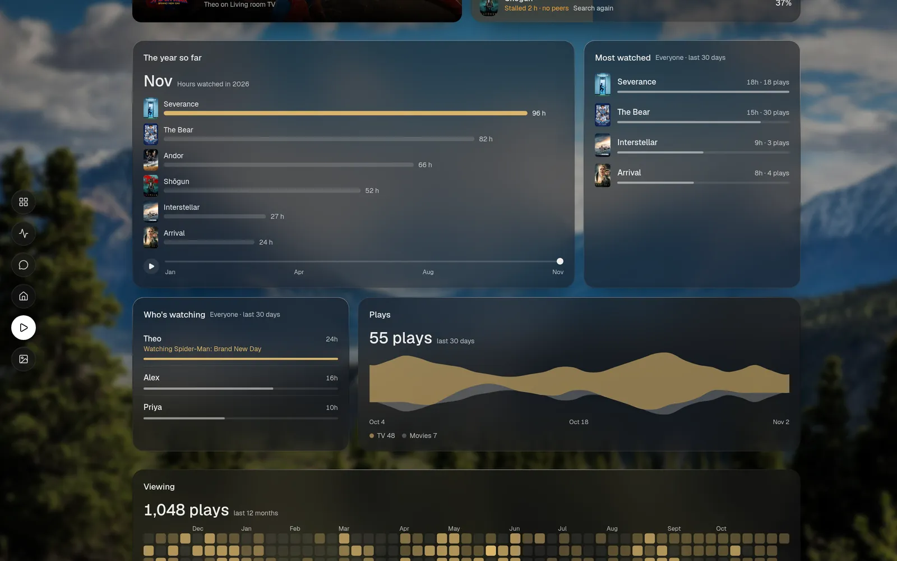
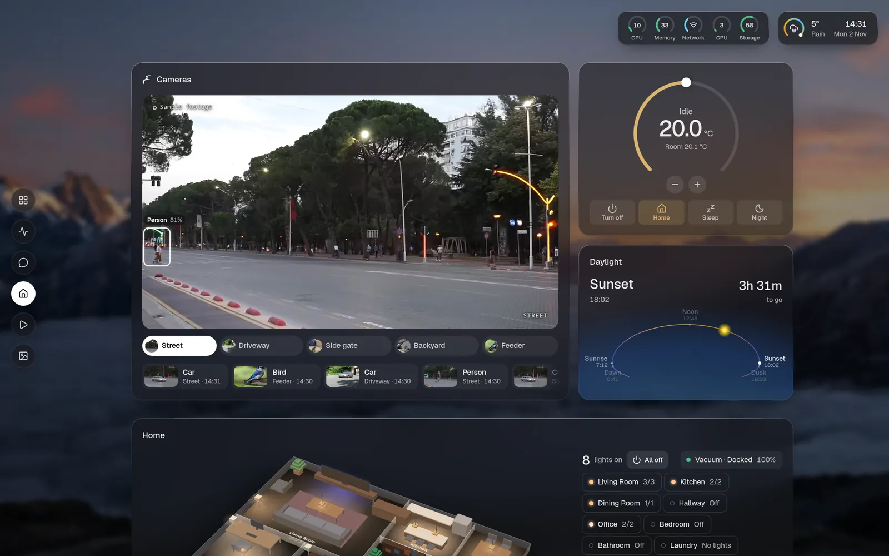
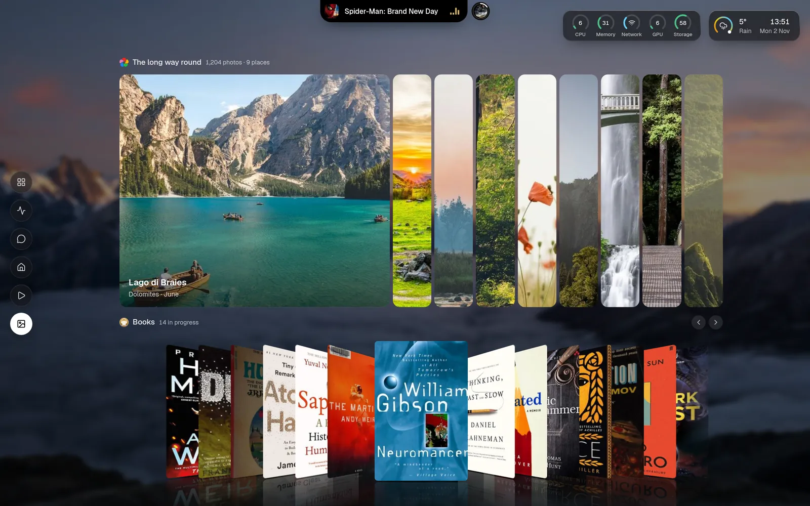
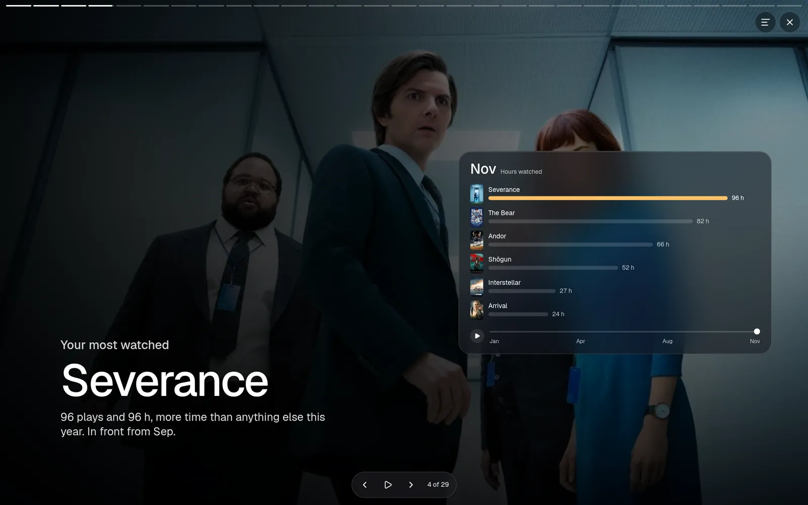
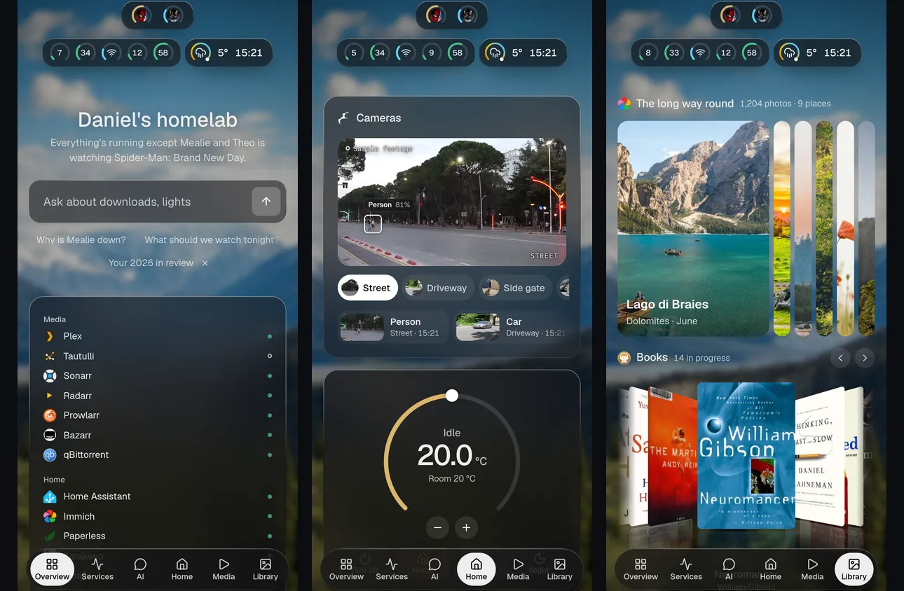

<div align="center">


# Valet

**Talk to your homelab.**

A fast, beautiful, self-hosted homepage with an optional assistant that only gets the keys you hand it.

[](https://github.com/IbrahimIrfan/valet/actions/workflows/ci.yml)
[](LICENSE)
[](package.json)
[](tsconfig.json)
[](docs/services.md)

[**Live demo**](https://demo.askvalet.dev) · [**Docs**](https://askvalet.dev) · [Quick start](#quick-start) · [Integrations](#integrations) · [Security](#security) · [Roadmap](ROADMAP.md)

<br>

<a href="https://demo.askvalet.dev"></a>

</div>

<br>

## Why Valet

A homelab homepage should tell you how things are at a glance, let you act without opening ten apps, and answer when you ask. Valet does all three from one YAML file.

- **Pictures over words.** Live cards, posters, charts, a 3D floor plan from your robot vacuum's map and a 3D model of your PC.
- **Ask instead of hunt.** "Why is Mealie down?" gets the logs read and a one-click restart. Answers arrive as the same live cards the page uses, not walls of text.
- **The assistant is optional.** Valet is a complete homepage with no model at all, so nothing here depends on AI.
- **The valet key.** Like the key that drives the car but can't open the boot: you decide what the assistant can reach, it never sees your API keys, and anything that changes something asks you first.
- **Light.** One Node process, about 65 MB of RAM and a 165 MB image. The page is about 95 KB of gzipped JavaScript, and the assistant loads only when you ask something.
- **Yours.** MIT licensed, runs on your hardware, and works with local models (Ollama, llama.cpp, vLLM, LM Studio) or hosted ones (OpenRouter, OpenAI, Anthropic).

## A look around

<table>
<tr>
<td width="50%"><br><b>Talk to it.</b> It reads freely and asks before it changes anything.</td>
<td width="50%"><br><b>Run the house.</b> Lights, rooms, vacuum and PC lighting, in 3D.</td>
</tr>
<tr>
<td><br><b>Keep an eye on things.</b> Traffic, drives, containers and which updates need reading first.</td>
<td><br><b>See what you watched.</b> A race through the year, who's watching and a year of days.</td>
</tr>
<tr>
<td><br><b>Check the cameras.</b> Live views and what they noticed, with the thermostat beside them.</td>
<td><br><b>Enjoy your library.</b> Albums that slide open and Cover Flow for anything with a cover.</td>
</tr>
<tr>
<td><br><b>Relive the year.</b> A story of your homelab, written from real numbers with no model.</td>
<td><br><b>Take it with you.</b> Built for phones, not squeezed onto them.</td>
</tr>
</table>

> [!TIP]
> The [live demo](https://demo.askvalet.dev) is a sandbox. Restart things, turn off the lights and break what you like: every visitor gets a private copy and nothing is saved.

## Quick start

```sh
mkdir valet && cd valet
docker run -d --name valet -p 127.0.0.1:7575:7575 \
  -v ./config:/config -v ./data:/app/data --env-file .env \
  ghcr.io/ibrahimirfan/valet:latest
```

Open <http://localhost:7575>. On first start Valet writes a starter `config/config.yaml` and the page walks you through it. A [`docker-compose.example.yml`](docker-compose.example.yml) is there too.

Copy [`.env.example`](.env.example) to `.env` for your keys: it says where each one lives in that app's settings. Secrets never go in the config, which refers to them as `${NAME}`, so you can share or commit it safely.

```yaml
# config/config.yaml
title: Home
integrations:
  plex:      { type: tautulli, url: http://tautulli:8181, apiKey: "${TAUTULLI_KEY}" }
  downloads: { type: qbittorrent, url: http://qbittorrent:8080, username: "${QBIT_USER}", password: "${QBIT_PASS}" }
  dns:       { type: pihole, url: http://pi.hole, password: "${PIHOLE_PASSWORD}" }
assistant:                        # optional
  provider: openai-compatible
  baseURL: http://ollama:11434/v1
  model: your-model
  access: { default: read, downloads: control }
```

Edits apply live, and `docker exec valet node dist/server.js config check` names every problem in the file. [`config.example.yaml`](config.example.yaml) is a full example, and [docs/configuration.md](docs/configuration.md) lists every option.

<details>
<summary><b>Run from source</b> (Node 22.18+)</summary>

```sh
git clone https://github.com/IbrahimIrfan/valet.git && cd valet
npm install
npm run build
cp config.example.yaml config.yaml   # then edit
npm start
```

</details>

## Features

| | |
|---|---|
| **Cards** | A small catalog of cards, each working as a tile, a card and an answer in chat |
| **Views** | Draw any numbers as any chart and any pictures as any gallery: `view: coverflow`, `view: race`, `view: album` |
| **Layout** | Sections, tabs, sizes and a bento grid, all from YAML |
| **Appearance** | Theme, colours, font, glass, wallpapers and density |
| **The island** | A live notch for what's playing, downloading or finishing |
| **Palette** | `⌘K` to find a service, run an action or ask a question |
| **Reminders** | "Tell me when this download finishes", even with the page closed |
| **Year in review** | A shareable story of your homelab, written from your services' own numbers |
| **MCP** | Point Valet at any MCP server and its tools join the assistant, under the same rules |
| **Sandbox** | `sandbox: true` saves nothing and gives each visitor a private copy, for demos |

## Integrations

**186 services** work out of the box, and [the full list is here](docs/services.md). `type: api` turns any other JSON API into a card from YAML alone.

| | |
|---|---|
| **Media** | Plex, Tautulli, Jellyfin, Emby, Navidrome, Audiobookshelf, Komga, RomM, Immich |
| **Downloads** | Sonarr, Radarr, Lidarr, Prowlarr, Bazarr, Seerr, qBittorrent, Transmission, SABnzbd |
| **Home** | Home Assistant, Frigate, robot vacuums, thermostats, RGB and PC lighting |
| **Documents** | Paperless, Karakeep, Mealie, Tandoor, Miniflux, Nextcloud, calendars from any iCal link |
| **Infrastructure** | Docker, Proxmox, TrueNAS, Unraid, Glances, Scrutiny, systemd services through a read-only agent |
| **Network** | Pi-hole, AdGuard Home, Tailscale, Uptime Kuma, Caddy, Traefik, UniFi |
| **AI** | Ollama and local model monitors |
| **The rest** | Weather, RSS, Hacker News, Reddit, GitHub releases, markets |

Writing your own is usually about ten lines. An integration is one TypeScript file with its config, widgets, actions and assistant tools. Community integrations are single files you drop into `data/integrations/`: see [docs/integrations.md](docs/integrations.md), [docs/plugins.md](docs/plugins.md) and [`examples/hello-plugin.mjs`](examples/hello-plugin.mjs).

## Security

Valet holds keys to your services, so it's built to keep them.

- **Keys stay on the server.** They never reach the browser or the model, and they're redacted from anything Valet sends out.
- **Read-only by default.** Controls stay off until you turn on sign-in or trust your network.
- **You grant access per integration.** Each is `none`, `read`, `write` or `control`.
- **Every change asks first.** `write` and `control` tools wait for your approval, on a card that says exactly what will happen.

```yaml
assistant:
  access: { default: read, home: control, downloads: none }
```

[SECURITY.md](SECURITY.md) has the threat model, how to report a vulnerability and the least-privilege key to give each service.

## Documentation

| | |
|---|---|
| [Docs site](https://askvalet.dev) | Guides, and a page with screenshots for every integration and card |
| [Configuration](docs/configuration.md) | Every option |
| [Supported services](docs/services.md) | The full list |
| [Writing integrations](docs/integrations.md) | The integration API |
| [Plugins](docs/plugins.md) | Single-file community integrations |
| [Roadmap](ROADMAP.md) | What's planned |
| [Changelog](CHANGELOG.md) | What's changed |

## Contributing

Contributions are welcome, and new integrations are the easiest place to start. [CONTRIBUTING.md](CONTRIBUTING.md) covers setup, and [AGENTS.md](AGENTS.md) holds the design and code principles. In short: `npm install`, `npm run dev`, and `npm test` before a pull request.

## Licence

[MIT](LICENSE). Geist is bundled under the SIL Open Font License. Third-party credits are on the [credits page](https://askvalet.dev/credits/). Product names and logos belong to their owners, and Valet isn't affiliated with any of them.
