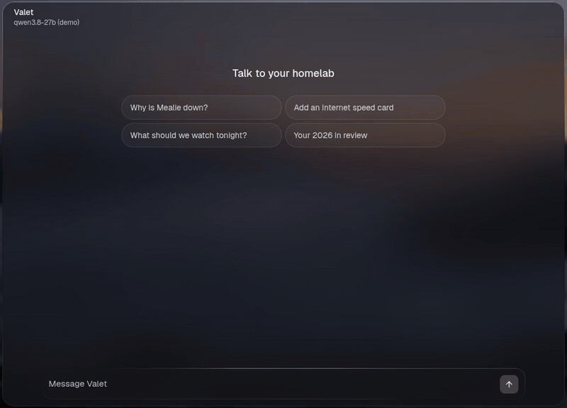
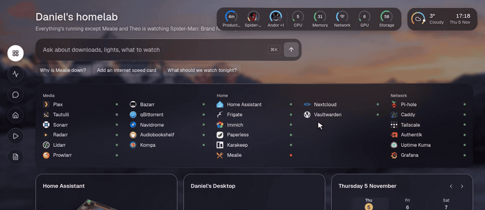

<div align="center">


# Valet

**Talk to your homelab.**

A self-hosted, open-source, AI-native homepage.

[](https://github.com/askvalet/valet/actions/workflows/ci.yml)
[](LICENSE)
[](package.json)
[](tsconfig.json)
[](docs/services.md)

[**Live demo**](https://demo.askvalet.dev) · [**Docs**](https://askvalet.dev) · [Quick start](#quick-start) · [Changelog](CHANGELOG.md)

<br>

<a href="https://askvalet.dev/film/valet.mp4"></a>

<sub>▶ <a href="https://askvalet.dev/film/valet.mp4">Watch the one-minute film</a> · or <a href="https://demo.askvalet.dev">try the demo</a>, right in your browser</sub>

</div>

<br>

## Why Valet

Valet is a homepage for your homelab that can also do things.

### The front door to your homelab

Instead of opening five different tabs to work out what's going on, just open Valet.
It shows what's happening across all your services, and you can act on it right there. Instead of just being a page with
links and a status dot, Valet is meant to be powerful and actionable.

<p align="center"></p>

<br>

### AI-native, if you want it

Ask Valet anything about your homelab. Use a local model or a hosted one. Valet knows
its own documentation, so you can use it to build itself! Anything it changes waits for your approval, and Valet
works just fine with the AI switched off.

<table><tr>
<td width="50%" valign="top"><br><sub>"Who's watching?" "What should we watch tonight?" Then "Pause Pi-hole", which waits for your approval.</sub></td>
<td width="50%" valign="top"><br><sub>"Add an internet speed card." Valet edits its own config, after asking first.</sub></td>
</tr></table>

<br>

### Updates in real time

Everything on the page is live. Progress bars move, numbers tick over, and new things appear as they happen, with no refreshing. Hover anything in the top bar for its details: what's playing, a download, the CPU or the weather.

<p align="center"></p>

<br>

### Made to be enjoyed

Live cards, real artwork, smooth animations and 3D models. It's a page
you'll want to look at and use.

<p align="center"><br><sub>Pick a room, change its lights, and send the vacuum, which drives through the house.</sub></p>

<br>

### Flexible, and light

One YAML file controls everything, with 185 integrations and a simple way to add your own. It
runs as one Node process, uses about 45 MB of RAM on a fresh install, and the image is 165 MB.
Add it to your phone's Home Screen and it's an app, with [its own notifications](https://askvalet.dev/start/app/).

<p align="center"></p>

<br>

### Security first

Valet is read-only until you turn on sign-in or tell it your network is private. Your API keys stay on the server, so
neither the browser nor the AI ever sees them, and the assistant only gets the access you give it, one integration at a
time. Anything the assistant changes asks first. It runs on your own hardware, with no account and no telemetry. The
[security docs](https://askvalet.dev/security/) cover the rest.

<br>

## Quick start

```sh
mkdir valet && cd valet && touch .env   # secrets go in .env, as ${NAME} in the config
docker run -d --name valet -p 127.0.0.1:7575:7575 \
  -v ./config:/config -v ./data:/app/data --env-file .env \
  ghcr.io/askvalet/valet:latest
```

Open <http://localhost:7575> and the page walks you through the rest. The [install guide](https://askvalet.dev/start/install/) covers Docker Compose and running from source.

## Documentation

Everything else lives at **[askvalet.dev](https://askvalet.dev)**:

- [Your first config](https://askvalet.dev/start/first-config/)
- [185 integrations](https://askvalet.dev/integrations/), each with screenshots
- [The assistant](https://askvalet.dev/assistant/)
- [Security](https://askvalet.dev/security/)
- [Configuration reference](https://askvalet.dev/reference/configuration/)
- [Build an integration](https://askvalet.dev/build/)

## Contributing

Contributions are welcome, and new integrations are the easiest place to start. See [CONTRIBUTING.md](CONTRIBUTING.md).

## Licence

[MIT](LICENSE). Product names and logos belong to their owners, and Valet isn't affiliated with any of them.
