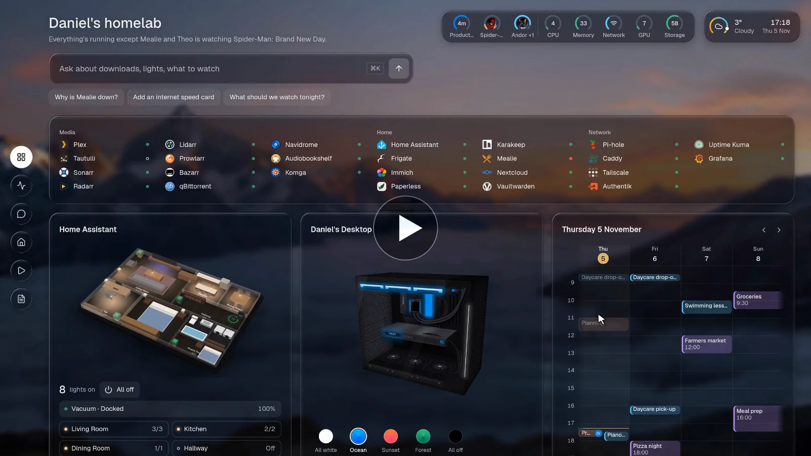
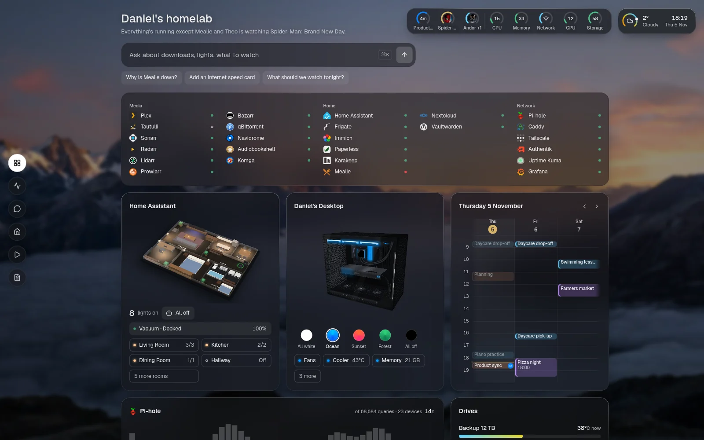
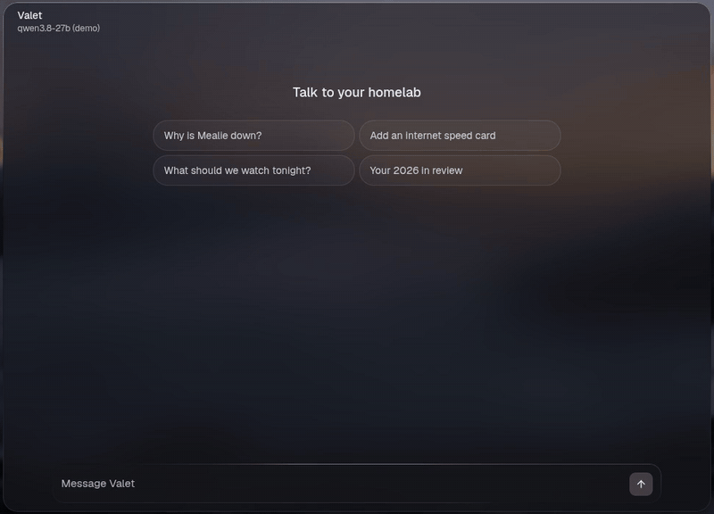
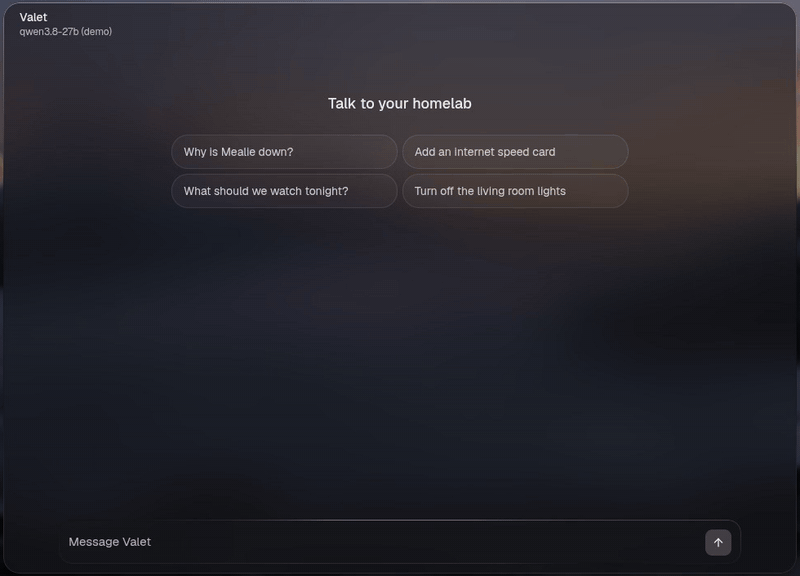
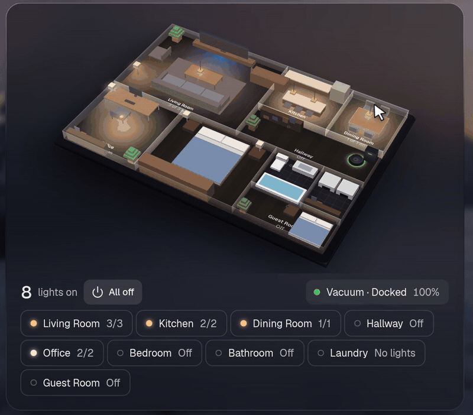
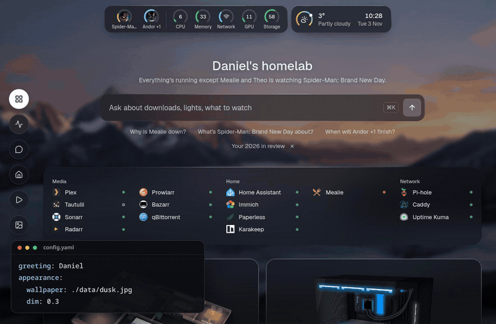

<div align="center">


# Valet

**Talk to your homelab.**

A self-hosted, open-source, AI-native homepage.

[](https://github.com/askvalet/valet/actions/workflows/ci.yml)
[](LICENSE)
[](package.json)
[](tsconfig.json)
[](docs/services.md)

[**Live demo**](https://demo.askvalet.dev) · [**Docs**](https://askvalet.dev) · [Quick start](#quick-start) · [Changelog](CHANGELOG.md)

<br>

<a href="https://askvalet.dev/film/valet.mp4"></a>

<sub>▶ <a href="https://askvalet.dev/film/valet.mp4">Watch the 70-second film</a> · or <a href="https://demo.askvalet.dev">try the demo</a>, right in your browser</sub>

</div>

<br>

## Why Valet

Valet is a homepage for your homelab that can also do things.

**The front door to your homelab.** Instead of opening Plex, qBittorrent, Home Assistant and five other tabs to work
out what's going on, you open Valet. It shows what's happening across all your services, like what's playing, what's
downloading or what just went down and why, and you can act on it right there: pause a download, restart a service,
turn off the lights. Most dashboards are a page of links with a status dot; this is meant to be the one page you check.



**AI-native, if you want it.** Ask why something is down and it reads the logs, or ask for a new card and it edits the
config for you. Use a local model or a hosted one. Every change waits for your approval, and Valet works fine with the AI
switched off.





**Made to be enjoyed.** Live cards, real artwork, smooth animations and 3D models of your house and PC. It's a page
you'll want to look at and use.



**Flexible, and light.** One YAML file controls everything, with 185 integrations and a simple way to add your own. It
runs as one Node process, uses about 45 MB of RAM on a fresh install, and the image is 166 MB.



## Quick start

```sh
mkdir valet && cd valet && touch .env   # secrets go in .env, as ${NAME} in the config
docker run -d --name valet -p 127.0.0.1:7575:7575 \
  -v ./config:/config -v ./data:/app/data --env-file .env \
  ghcr.io/askvalet/valet:latest
```

Open <http://localhost:7575> and the page walks you through the rest. The [install guide](https://askvalet.dev/start/install/) covers Docker Compose and running from source.

## Documentation

Everything else lives at **[askvalet.dev](https://askvalet.dev)**:

- [Your first config](https://askvalet.dev/start/first-config/)
- [185 integrations](https://askvalet.dev/integrations/), each with screenshots
- [The assistant](https://askvalet.dev/assistant/)
- [Security](https://askvalet.dev/security/)
- [Configuration reference](https://askvalet.dev/reference/configuration/)
- [Build an integration](https://askvalet.dev/build/)

## Contributing

Contributions are welcome, and new integrations are the easiest place to start. See [CONTRIBUTING.md](CONTRIBUTING.md).

## Licence

[MIT](LICENSE). Product names and logos belong to their owners, and Valet isn't affiliated with any of them.
